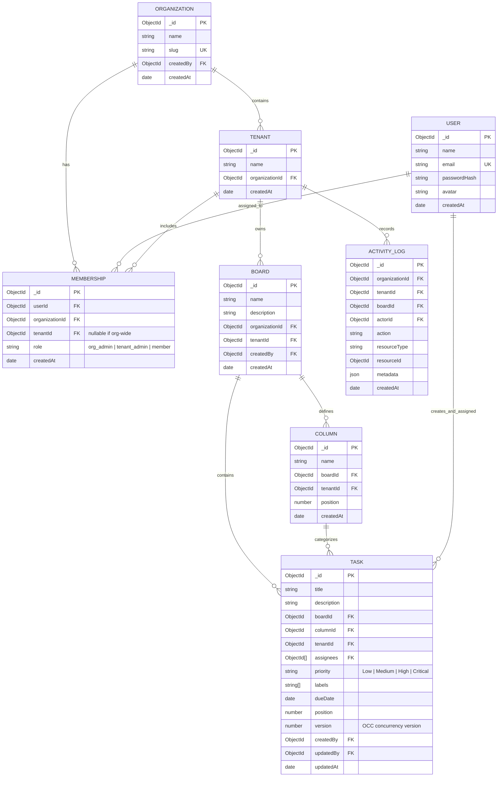

# Flowspace — Real-Time Collaborative Kanban SaaS
### Multi-Organization, Multi-Tenant Architecture

> Flowspace is an enterprise-grade collaborative task management platform supporting multi-organization workspaces, strict tenant (branch) data isolation, live real-time synchronization, optimistic UI mutations, and optimistic concurrency control (OCC).

---

## 📑 Table of Contents
1. [Architecture Overview](#1-architecture-overview)
2. [Tenancy Model & Data Isolation](#2-tenancy-model--data-isolation)
3. [Database Schema & ER Diagram](#3-database-schema--er-diagram)
4. [Role-Based Access Control (RBAC)](#4-role-based-access-control-rbac)
5. [Optimistic Concurrency Control (OCC)](#5-optimistic-concurrency-control-occ)
6. [Real-Time Collaboration & WebSockets](#6-real-time-collaboration--websockets)
7. [Undo / Redo Architecture](#7-undo--redo-architecture)
8. [REST API & WebSocket Documentation](#8-rest-api--websocket-documentation)
9. [Pre-Seeded Demo Accounts](#9-pre-seeded-demo-accounts)
10. [Setup & Execution Guide](#10-setup--execution-guide)

---

## 1. Architecture Overview

Flowspace is structured as a decoupled full-stack application following a modular architecture:

```
flowspace/
├── backend/
│   ├── src/
│   │   ├── config/          # MongoDB Mongoose connection
│   │   ├── controllers/     # HTTP Request/Response orchestrators
│   │   ├── middleware/      # Auth, Tenant Isolation, RBAC, Validation, Error Handling
│   │   ├── models/          # 8 Mongoose Schemas (Tenant-scoped)
│   │   ├── routes/          # Express Routers (Auth, Orgs, Tenants, Boards, Columns, Tasks)
│   │   ├── services/        # Activity Logging & socket event dispatch
│   │   ├── sockets/         # Socket.IO handlers, room authorization, presence tracking
│   │   ├── utils/           # JWT helpers, seed script, automated integration tests
│   │   ├── validators/      # Zod validation schemas
│   │   ├── app.js           # Express app setup (CORS, Helmet, Rate limiting)
│   │   └── server.js        # Node.js HTTP server & Socket.IO initialization
│   ├── .env
│   └── package.json         # ("type": "module")
├── frontend/
│   ├── src/
│   │   ├── components/
│   │   │   ├── board/       # KanbanBoard, Column, TaskCard, TaskDetail, FilterBar
│   │   │   ├── common/      # Avatar, ConflictDialog
│   │   │   ├── layout/      # Sidebar, Topbar, AppLayout
│   │   │   ├── organization/# CreateOrg, CreateTenant, CreateBoard, MemberManagement
│   │   │   └── activity/    # ActivityDrawer
│   │   ├── context/         # Auth, Workspace, Socket, Board State contexts
│   │   ├── pages/           # LoginPage (with 1-click Demo), RegisterPage, BoardView
│   │   ├── services/        # Axios API client
│   │   ├── App.jsx          # Route configuration
│   │   ├── main.jsx         # React DOM entry
│   │   └── index.css        # Tailwind CSS
│   ├── vite.config.js       # Vite build & proxy config
│   └── package.json
└── README.md
```

---

## 2. Tenancy Model & Data Isolation

### Tenancy Hierarchy:
```
Organization (Acme Technologies)
│
├── Branch/Tenant A (Chennai Branch)
│   ├── Development Board
│   │   ├── Columns (Backlog, To Do, In Progress, In Review, Done)
│   │   └── Tasks (Scoped to tenantId)
│   └── Marketing Board
│
└── Branch/Tenant B (Bengaluru Branch)
    ├── Engineering Board
    └── Operations Board
```

### Strict Isolation Rules:
1. **Tenant-Scoped Foreign Keys:** All operational data (`boards`, `columns`, `tasks`, `activity_logs`) store an explicit `tenantId`.
2. **Server-Side Guard (`requireTenantAccess`):**
   - Extracts `tenantId` (directly or resolved from `boardId`, `columnId`, or `taskId`).
   - Checks user memberships in MongoDB:
     - Is the user an `org_admin` of the parent organization? If yes, access is granted.
     - Does the user possess a valid `Membership` record for this specific `tenantId`? If yes, assigned role is resolved.
     - If neither condition matches, immediately terminates with **HTTP 403 Forbidden**.
3. **Compound Query Filter:** Controllers never run unscoped queries like `Task.findById(id)`. Instead, every modification executes with `{ _id: taskId, tenantId: req.tenant._id }`.
4. **WebSocket Room Gating:** A user cannot subscribe to a `board:<boardId>` or `tenant:<tenantId>` room without verifying their membership first.

---

## 3. Database Schema & ER Diagram



---

## 4. Role-Based Access Control (RBAC)

| Capability | Organization Admin | Tenant Admin | Member |
|---|---|---|---|
| Manage Org Settings & Branches | ✅ Full authority | ❌ No | ❌ No |
| Create New Branches (Tenants) | ✅ Yes | ❌ No | ❌ No |
| Manage Tenant Members & Roles | ✅ Org-wide | ✅ Assigned tenant | ❌ No |
| Create / Delete Boards | ✅ Yes | ✅ Assigned tenant | ❌ No |
| Create / Rename / Delete Columns | ✅ Yes | ✅ Assigned tenant | ❌ No |
| Create / Update / Move Tasks | ✅ Yes | ✅ Yes | ✅ Yes |
| Delete Tasks | ✅ Yes | ✅ Yes | ✅ Yes |
| Access other tenants' data | ✅ Authorized scope | ❌ Strictly Denied (403) | ❌ Strictly Denied (403) |

---

## 5. Optimistic Concurrency Control (OCC)

When multiple collaborators edit tasks simultaneously, Flowspace prevents silent data loss through document versioning:

1. **Version Tracking:** Every task has an integer `version` field (starting at `1`).
2. **Conditional Updates:** When editing a task, the frontend submits `{ ...updates, expectedVersion: task.version }`.
3. **Atomic Version Verification:**
   ```javascript
   const updatedTask = await Task.findOneAndUpdate(
     { _id: taskId, tenantId: req.tenant._id, version: expectedVersion },
     { $set: updates, $inc: { version: 1 }, updatedBy: req.user._id },
     { new: true }
   );
   ```
4. **Conflict Detection (HTTP 409):**
   If `version !== expectedVersion`, the server halts the update and responds with:
   ```json
   {
     "status": "fail",
     "error": "Conflict: Task was modified by another user",
     "currentVersion": 4,
     "serverTask": { ... }
   }
   ```
5. **Interactive Conflict Resolution Modal:**
   The frontend automatically intercepts the `409 Conflict` and triggers a side-by-side comparison modal allowing the user to either:
   - **Accept Server State:** Discard local changes and reload the latest version.
   - **Overwrite (Force Update):** Reapply changes on top of the latest version.

---

## 6. Real-Time Collaboration & WebSockets

Flowspace leverages **Socket.IO** with authenticated, authorized channel isolation:

- **JWT Handshake Authentication:** Every incoming socket connection is authenticated using verified JWT credentials.
- **Authorized Room Joins:** Sockets can only join `tenant:<tenantId>` and `board:<boardId>` rooms after verifying membership on the server.
- **Live Events Broadcasted:**
  - `task:created` — Appends task card in all connected clients immediately.
  - `task:updated` — Live updates task properties.
  - `task:moved` — Coordinates cross-column drag-and-drop repositioning in real time.
  - `task:deleted` — Removes task card instantly.
  - `column:created` / `column:updated` / `column:deleted` — Board structure synchronization.
- **Presence Indicators:** Live tracking of users currently viewing a board with active user avatar pills and online counts.
- **Resilient Reconnection:** Handles network dropouts gracefully and resynchronizes board state upon reconnection.

---

## 7. Undo / Redo Architecture

Flowspace features an integrated **Undo/Redo stack** with keyboard shortcuts (`Ctrl+Z` / `Ctrl+Y`):
- When a user moves or reorders a task, the previous position, column, and version are pushed onto the client's `undoStack`.
- Clicking Undo sends a reverse move mutation with OCC validation, safely returning the task to its previous state.
- Redo reverses the undo mutation.
- The stack integrates with server-side validation to avoid overwriting newer concurrent modifications.

---

## 8. REST API & WebSocket Documentation

### Authentication Endpoints
- `POST /api/auth/register` — Create a new user account.
- `POST /api/auth/login` — Sign in and receive JWT token + secure cookie.
- `POST /api/auth/logout` — Clear session cookies.
- `GET /api/auth/me` — Retrieve authenticated user profile & memberships.

### Organizations & Tenants
- `GET /api/organizations` — List organizations accessible to user.
- `POST /api/organizations` — Create organization (auto-assigns `org_admin` & default branch).
- `GET /api/organizations/:organizationId` — Get organization details.
- `POST /api/organizations/:organizationId/tenants` — Create branch (Org Admin only).
- `GET /api/organizations/:organizationId/tenants` — List branches in organization.

### Tenant Members & Boards
- `GET /api/tenants/:tenantId/members` — List members assigned to branch.
- `POST /api/tenants/:tenantId/members` — Invite user to branch by email (`tenant_admin` | `member`).
- `PATCH /api/tenants/:tenantId/members/:membershipId` — Change member role.
- `DELETE /api/tenants/:tenantId/members/:membershipId` — Remove member.
- `GET /api/tenants/:tenantId/boards` — List boards in branch.
- `POST /api/tenants/:tenantId/boards` — Create board (auto-generates 5 default columns).
- `GET /api/tenants/:tenantId/activity` — Retrieve branch activity logs.

### Board & Task Mutations
- `GET /api/boards/:boardId` — Get board columns and tasks.
- `POST /api/boards/:boardId/columns` — Add column.
- `PATCH /api/columns/:columnId` — Rename/reorder column.
- `DELETE /api/columns/:columnId` — Delete column.
- `POST /api/boards/:boardId/tasks` — Create task.
- `PATCH /api/tasks/:taskId` — Update task (OCC validated with `expectedVersion`).
- `POST /api/tasks/:taskId/move` — Drag-and-drop task move across/within columns.
- `DELETE /api/tasks/:taskId` — Delete task.

### Socket.IO Real-Time Events
| Event Name | Direction | Payload |
|---|---|---|
| `board:join` | Client -> Server | `{ boardId }` (Server checks RBAC before joining) |
| `board:leave` | Client -> Server | `{ boardId }` |
| `presence:updated` | Server -> Room | `{ boardId, activeUsers: [...] }` |
| `task:created` | Server -> Room | `Task` object |
| `task:updated` | Server -> Room | `Task` object |
| `task:moved` | Server -> Room | `{ task, sourceColumnId, targetColumnId, newPosition }` |
| `task:deleted` | Server -> Room | `{ taskId, boardId, columnId }` |
| `conflict:detected` | Server -> Room | `{ taskId, currentVersion, attemptedVersion }` |

---

## 9. Pre-Seeded Demo Accounts

The application includes pre-configured demo accounts. The login screen features **1-click Quick Login buttons** for each role:

| Name | Role | Email | Password | Branch Scope |
|---|---|---|---|---|
| **Sarah Connor** | Org Admin | `admin@acme.com` | `password123` | Acme Technologies (Org-Wide) |
| **Rajesh Kumar** | Tenant Admin | `chennai.admin@acme.com` | `password123` | Chennai Branch |
| **Priya Sharma** | Member | `chennai.dev@acme.com` | `password123` | Chennai Branch |
| **Alex Vance** | Tenant Admin | `bengaluru.admin@acme.com` | `password123` | Bengaluru Branch |
| **David Kim** | Member | `bengaluru.dev@acme.com` | `password123` | Bengaluru Branch |

---

## 10. Setup & Execution Guide

### Prerequisites
- Node.js (v18 or higher)
- MongoDB running locally at `mongodb://127.0.0.1:27017`

### Step 1: Environment Variables
Backend environment variables are configured in `backend/.env`:
```env
PORT=5000
MONGODB_URI=mongodb://127.0.0.1:27017/flowspace
JWT_SECRET=flowspace_super_secret_jwt_key_2026_collaborative_kanban
JWT_EXPIRES_IN=7d
NODE_ENV=development
CLIENT_URL=http://localhost:5173
```

### Step 2: Seed the Database
```bash
npm run seed
# or: cd backend && npm run seed
```

### Step 3: Run the Automated Integration Tests
```bash
npm run test:backend
# or: cd backend && node src/utils/testIntegration.js
```

### Step 4: Start the Backend & Frontend Servers
In terminal 1 (Backend API & Socket.IO):
```bash
cd backend
npm run dev
```

In terminal 2 (Frontend Client):
```bash
cd frontend
npm run dev
```

Open `http://localhost:5173` in your browser. Use the 1-click demo buttons on the login page to sign in and collaborate!
